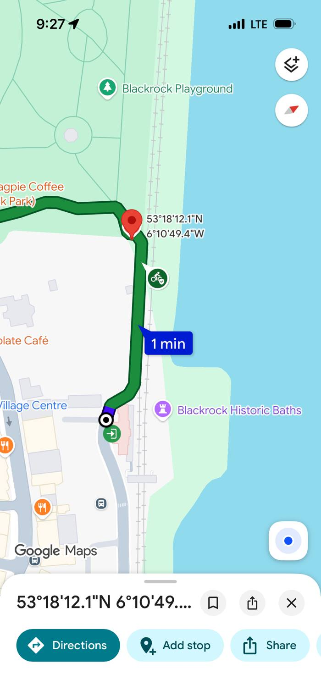

Part of [Cycling infrastructure in Dublin](index.qmd). See also [Shankill to Killiney](shankill-killiney.qmd).

## The problem

Between Blackrock Park and Bath Place, at the entrance to Blackrock DART station, the Coastal Mobility Route squeezes into a single lane between high walls. It's the only direct link between the park's paths and the station, and Google Maps sends cycle routes through it.

The lane is about 1.2 metres wide ([Part 8 report](https://dlrcoco.citizenspace.com/infrastructure-climate-change/blackrock-dart-to-park-active-travel-scheme/supporting_documents/Part%208%20Report.pdf)), and about 90 metres of it has walls on both sides ([IrishCycle, January 2026](https://irishcycle.com/2026/01/12/path-cleared-for-upgrade-of-blackrock-dart-laneway-as-no-objections-to-cpo-received/)). Two bikes can't pass each other in it. Nor can a bike and a buggy, or two buggies. Signs tell people on bikes to dismount, so everyone queues at each end and goes through in turns. Local councillor Marie Baker put it plainly: "you end up flattening yourself against the wall if you come up to a cyclist" ([IrishCycle, April 2024](https://irishcycle.com/2024/04/22/warm-welcome-to-plan-to-replace-narrow-path-at-blackrock-dart-station-with-wide-passageway/)).

::: {.cycling-map}
{fig-alt="Google Maps screenshot showing a green cycle route turning south from Blackrock Park into a narrow lane beside the railway, ending at Blackrock DART station."}
:::

Lots of people use it. The council's traffic surveys in November 2022 counted several hundred cyclists and more than a thousand pedestrians a day along the route between 7am and 7pm, according to the scheme's planning report ([Part 8 report](https://dlrcoco.citizenspace.com/infrastructure-climate-change/blackrock-dart-to-park-active-travel-scheme/supporting_documents/Part%208%20Report.pdf)).

[View on OpenStreetMap](https://www.openstreetmap.org/?mlat=53.30336&mlon=-6.18039#map=18/53.30336/-6.18039)

## The fix: approved, land secured, not yet built

DLR's **Blackrock DART to Park Active Travel Scheme** replaces the lane with a new route through part of the garden of Deepwell House next door: 130 metres of two-way cycle track 3 to 3.65 metres wide, a separate 2 metre footpath, grass verges, and a new bridge over the Priory Stream. The old lane will be closed off ([DLR Part 8 report](https://dlrcoco.citizenspace.com/infrastructure-climate-change/blackrock-dart-to-park-active-travel-scheme/supporting_documents/Part%208%20Report.pdf); [DLR PPN](https://www.dlrppn.ie/proposed-development-blackrock-dart-to-park-active-travel-scheme-at-blackrock/)).

::: {.timeline .cycling-timeline}
::: {.timeline-step}
**April 2024**

Plan published
:::
::: {.timeline-step}
**June to August 2024**

Public consultation: 321 submissions, about 81% in favour as proposed
:::
::: {.timeline-step}
**October 2024**

Councillors approve the scheme
:::
::: {.timeline-step}
**November to December 2025**

Compulsory purchase order: no objections
:::
::: {.timeline-step}
**August 2026**

Lane closed 24 to 28 August for ground investigation
:::
::: {.timeline-step .is-next}
**Not yet scheduled**

Construction
:::
:::

- **Planning.** The Part 8 consultation ran from 28 June to 9 August 2024 and drew 321 submissions. Councillors agreed the Chief Executive's recommendations at their October 2024 meeting ([DLR](https://www.dlrcoco.ie/news/public-consultation/public-consulation-blackrock-dart-park-active-travel-scheme); [Citizen Space](https://dlrcoco.citizenspace.com/infrastructure-climate-change/blackrock-dart-to-park-active-travel-scheme/); [Chief Executive's report](https://dlrcoco.citizenspace.com/infrastructure-climate-change/blackrock-dart-to-park-active-travel-scheme/results/blackrockdarttopark-chiefexecutivereport.pdf)).
- **Land.** The council's compulsory purchase order for part of the Deepwell House garden went to An Coimisiún Pleanála (formerly An Bord Pleanála) on 11 November 2025 and closed with **no objections received** on 8 December 2025 ([case 323857](https://www.pleanala.ie/en-ie/case/323857); [IrishCycle, January 2026](https://irishcycle.com/2026/01/12/path-cleared-for-upgrade-of-blackrock-dart-laneway-as-no-objections-to-cpo-received/)). At the time, Cllr Baker said there was "some paperwork to be completed and then detailed design to take place before work commences."
- **Site investigation.** The council closed the lane from 24 to 28 August 2026 for ground investigation. Cllr Conor Dowling said: "While the main works will not commence for a few months, this is real progress" ([IrishCycle, August 2026](https://irishcycle.com/2026/08/06/closure-on-coastal-mobility-route-planned-this-month-ahead-of-works-to-fix-pinchpoint/)).
- **Construction.** As of 7 November 2026 I could find no published start date, construction period or budget. The council's report treats cost estimates as commercially sensitive.

## Questions for the council

1. When will construction of the Blackrock DART to Park Active Travel Scheme start, and how long will it take?
2. Has detailed design been completed, and has a contractor been appointed?
3. What's the published budget for the scheme?
4. During construction, what's the diversion for people walking and cycling between Blackrock Park and the station?

The scheme's contact is DLR's Capital Projects Office, [capitalprojects@dlrcoco.ie](mailto:capitalprojects@dlrcoco.ie).

## Sources

- Dún Laoghaire-Rathdown County Council, [Blackrock DART to Park Active Travel Scheme](https://www.dlrcoco.ie/news/public-consultation/public-consulation-blackrock-dart-park-active-travel-scheme) (consultation notice, updated 18 October 2024).
- Dún Laoghaire-Rathdown County Council, [consultation page and documents](https://dlrcoco.citizenspace.com/infrastructure-climate-change/blackrock-dart-to-park-active-travel-scheme/), including the [Part 8 report](https://dlrcoco.citizenspace.com/infrastructure-climate-change/blackrock-dart-to-park-active-travel-scheme/supporting_documents/Part%208%20Report.pdf) (Atkins, June 2024) and the [Chief Executive's report](https://dlrcoco.citizenspace.com/infrastructure-climate-change/blackrock-dart-to-park-active-travel-scheme/results/blackrockdarttopark-chiefexecutivereport.pdf) (October 2024).
- DLR Public Participation Network, [Proposed development: Blackrock DART to Park Active Travel Scheme](https://www.dlrppn.ie/proposed-development-blackrock-dart-to-park-active-travel-scheme-at-blackrock/), 1 July 2024.
- An Coimisiún Pleanála, [case 323857](https://www.pleanala.ie/en-ie/case/323857): Dún Laoghaire-Rathdown County Council Compulsory Purchase Order (Blackrock DART to Park Active Travel Scheme) Order, 2025.
- IrishCycle, [Warm welcome for plan to replace narrow path at Blackrock Dart station with wide passageway](https://irishcycle.com/2024/04/22/warm-welcome-to-plan-to-replace-narrow-path-at-blackrock-dart-station-with-wide-passageway/), 22 April 2024.
- IrishCycle, [Path cleared for upgrade of Blackrock Dart laneway as no objections to CPO received](https://irishcycle.com/2026/01/12/path-cleared-for-upgrade-of-blackrock-dart-laneway-as-no-objections-to-cpo-received/), 12 January 2026.
- IrishCycle, [Closure on Coastal Mobility Route planned this month ahead of works to fix pinchpoint](https://irishcycle.com/2026/08/06/closure-on-coastal-mobility-route-planned-this-month-ahead-of-works-to-fix-pinchpoint/), 6 August 2026.

Map screenshot: Fianaise, November 2026, CC BY 4.0.
