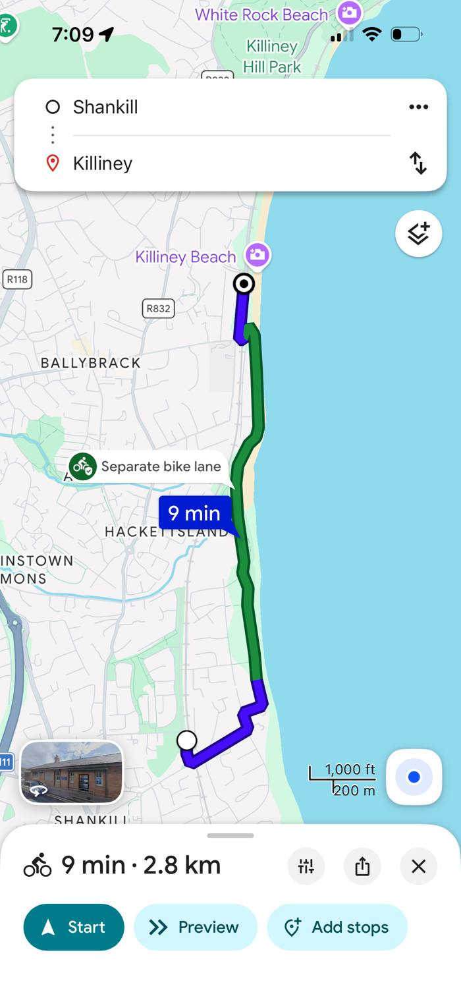
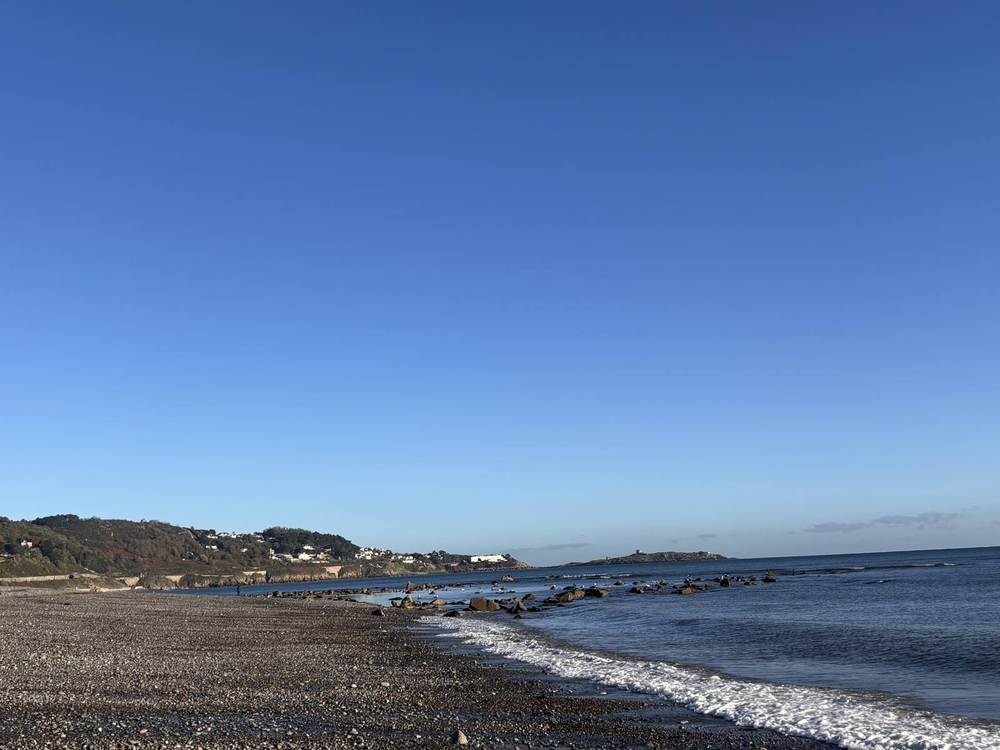
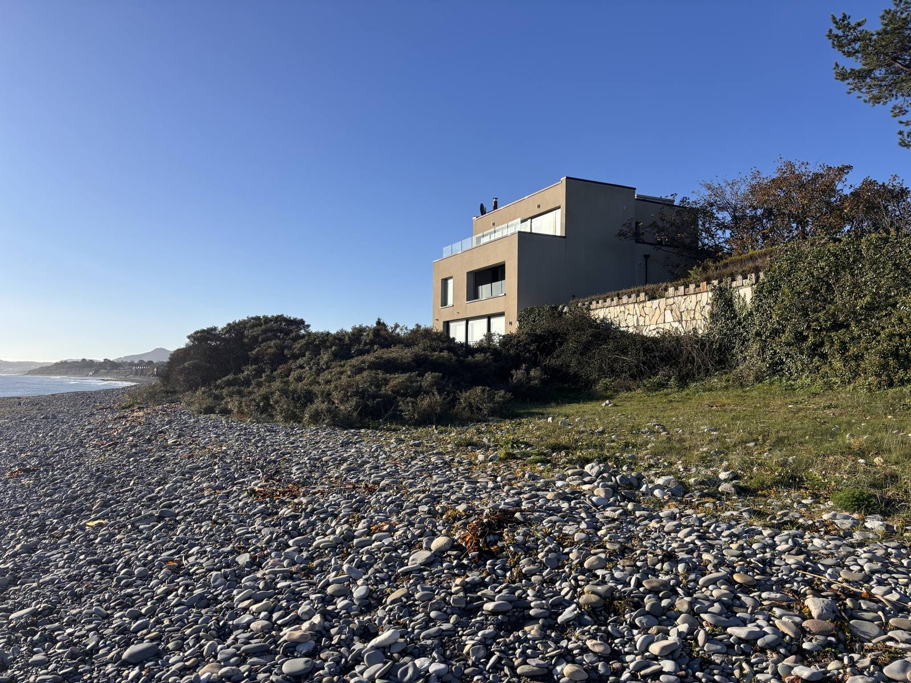
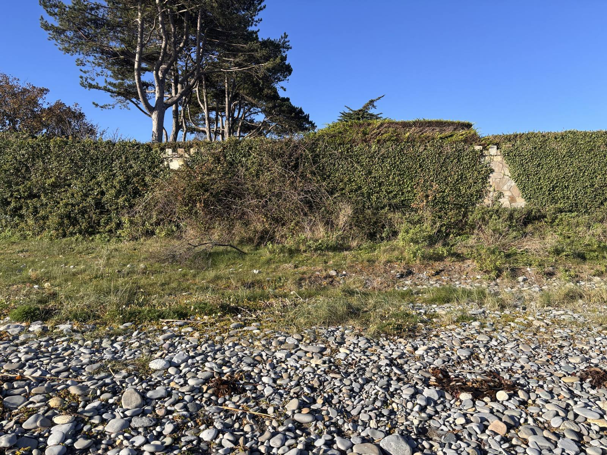
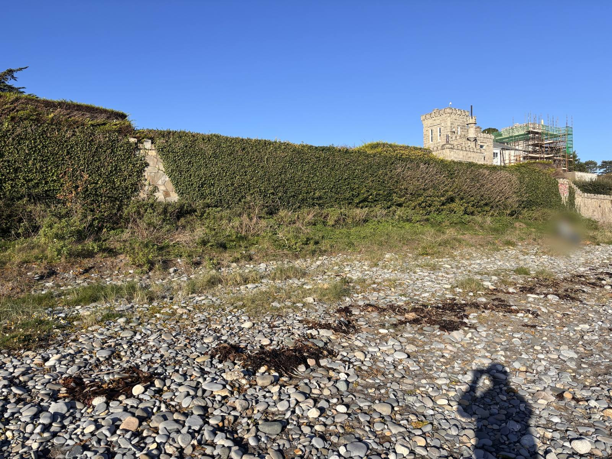
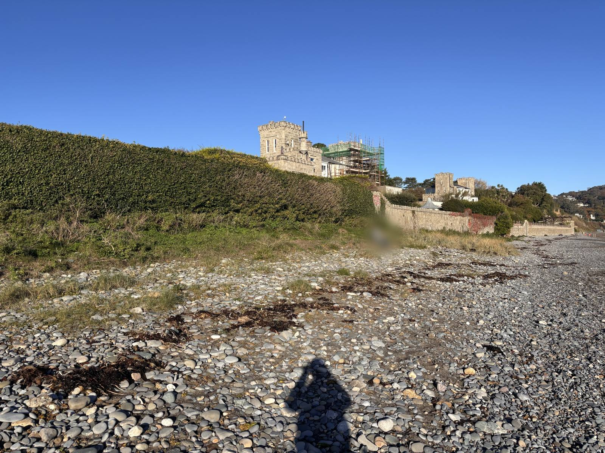

Part of [Cycling in Dublin](index.qmd). See also the [Blackrock DART laneway](blackrock-dart-laneway.qmd).

## What the map says

Ask Google Maps for cycling directions from Shankill to Killiney and it sends you down to the shore and north along the coast: 2.8 km, nine minutes, most of it shown in dark green and labelled **"Separate bike lane"**.

::: {.cycling-map}
{fig-alt="Google Maps screenshot of a 2.8 km, 9 minute cycle route from Shankill to Killiney, with the coastal section in green labelled Separate bike lane."}
:::

## What's actually there

From the Shankill end there's a short stretch of path. After that, the "bike lane" is the beach below the Shanganagh cliffs and the seafront walls: loose, rounded stones, shingle and rough grass, with no path, surface or markings of any kind. You can't ride a bike on it, and pushing one is hard work. It isn't usable with a buggy or a wheelchair either.

::: {layout-ncol=2}
{group="shankill"}

{group="shankill"}

{group="shankill"}

{group="shankill"}
:::

{group="shankill"}

The council agrees the shore is difficult. Its own page for the Corbawn Lane beach access, about 500 metres from Shankill DART station, says the strand "is unsuitable for those with disabilities due to the stoney terrain and dangers posed by unstable cliffs" ([DLR, Corbawn Lane](https://www.dlrcoco.ie/beaches/corbawn-lane)).

## Is anything planned?

I found no council or National Transport Authority plan for a walking or cycling path along this stretch of shore. What I did find:

- **The Coastal Mobility Route stops well north of here.** DLR's coastal cycleway runs from Booterstown and Blackrock to Sandycove and Dalkey ([DLR, Coastal Mobility Interventions](https://www.dlrcoco.ie/transportation-infrastructure/coastal-mobility-interventions)). There is no equivalent route from Killiney south to Shankill.
- **Coastal protection, not access.** In 2018 to 2019 DLR rebuilt the Corbawn Lane beach access and put rock armour along about 180 metres of cliff to the north, costing about €928,000 ([DLR, December 2018](https://www.dlrcoco.ie/news/general-news-press-releases/corbawn-lane-beach-access-and-coastal-protection-works-starts-10th); [Afloat](https://afloat.ie/marine-environment/coastal-notes/item/41547-landing-craft-vessel-assists-in-killiney-bay-coastal-protection-works-at-shanganagh-cliffs)). The works protected the cliff and the steps, not a route along the shore.
- **Irish Rail's sea defences.** Irish Rail's East Coast Railway Infrastructure Protection Project proposes rock armour and higher sea walls between Merrion Gates and Wicklow, including a section from Dalkey Tunnel to Shanganagh. It consulted the public in autumn 2025 and expects works to run to about 2029. RTÉ reported that "access routes to the public will be maintained and improved in some places", and that some beaches may get narrower ([RTÉ, September 2025](https://www.rte.ie/news/dublin/2025/0915/1533439-east-coast-railway-line)). If this goes ahead, it's the one current project that will reshape this shore, so it's the moment to ask for a path.
- **A coastal walk was suggested in 2017**, further south, from Bray to Shankill. A councillor proposed referring the idea to a council committee, and another pointed to Woodbrook Golf Club and cliff erosion as obstacles ([Bray People, July 2017](https://www.pressreader.com/ireland/bray-people/20170712/281698319787067)).

I haven't found any news coverage of the Google Maps label itself.

## Questions for the council

1. Does DLR consider the shore between Shankill and Killiney DART stations to be part of its cycle network? If not, will it ask Google to remove the "separate bike lane" label?
2. Are there plans for a walking and cycling path between Shankill and Killiney, along the coast or inland, and is it in the DLR or NTA cycle network plans?
3. Is DLR talking to Irish Rail about building public access, or a path, into the East Coast Railway Infrastructure Protection Project along this stretch?
4. Until there's a path, what's the recommended cycle route between Shankill and Killiney?

You can also report the label to Google directly: in Google Maps, tap the route and choose **Send feedback**.

## Sources

- Dún Laoghaire-Rathdown County Council, [Corbawn Lane](https://www.dlrcoco.ie/beaches/corbawn-lane) (beach information page).
- Dún Laoghaire-Rathdown County Council, [Corbawn Lane beach access and coastal protection works](https://www.dlrcoco.ie/news/general-news-press-releases/corbawn-lane-beach-access-and-coastal-protection-works-starts-10th), 30 November 2018, updated June 2023.
- Afloat, [Landing craft assists in Killiney Bay coastal protection works at Shanganagh cliffs](https://afloat.ie/marine-environment/coastal-notes/item/41547-landing-craft-vessel-assists-in-killiney-bay-coastal-protection-works-at-shanganagh-cliffs).
- Dún Laoghaire-Rathdown County Council, [Coastal Mobility Interventions](https://www.dlrcoco.ie/transportation-infrastructure/coastal-mobility-interventions), 2020.
- Dún Laoghaire-Rathdown County Council, [Shankill cliffs](https://www.dlrcoco.ie/shankill-cliffs).
- RTÉ News, [Irish Rail plans to protect the east coast railway line](https://www.rte.ie/news/dublin/2025/0915/1533439-east-coast-railway-line), 15 September 2025.
- Bray People, [Ryan suggests coastal walk from Bray beach to Shankill](https://www.pressreader.com/ireland/bray-people/20170712/281698319787067), 12 July 2017.

Photos and map screenshot: Fianaise, November 2026, CC BY 4.0.
